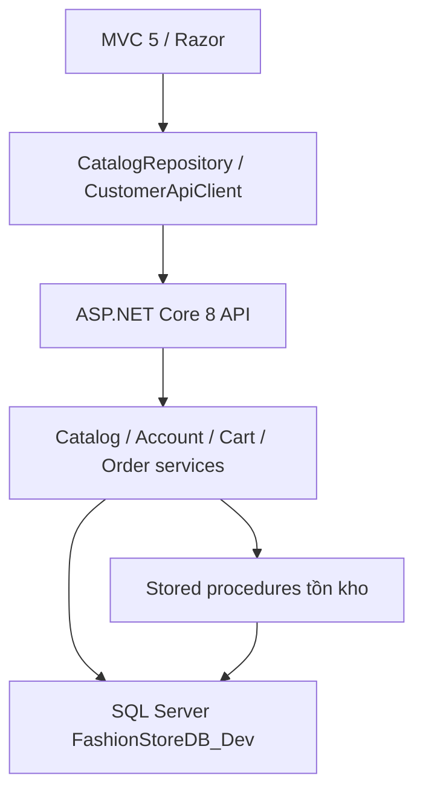

# CUSTOMER SOURCE AUDIT

Ngày: 2026-10-19. Nguồn duy nhất: ZIP đính kèm FashionStore_Task2_CheckoutOrders. Đã đối chiếu đề cương PDF trang 2–4, 6–7. Không có bản source Windows khác để so diff.

## Kiến trúc

## Ánh xạ trước sửa

|Module|Route|Controller MVC|View|API|SQL tables|Trạng thái đọc code|Cần làm|
|---|---|---|---|---|---|---|---|
|C01 Home|/|Home|Home/Index|GET products|SanPham, BienTheSanPham|API thật, ảnh editorial từ URL ngoài|Giữ dữ liệu, nối khuyến mãi|
|C02 Catalog|/Product|Product|Product/Index|GET products/categories|SanPham, LoaiSanPham, BienTheSanPham|Có phân trang; thiếu giá/size/màu/tồn|Bổ sung lọc tại SQL|
|C03 Details|/Product/Details/{id}|Product|Product/Details|GET products/{id}|HinhAnhSanPham, BienTheSanPham|Có SKU, thiếu giới hạn số lượng UI|Giới hạn SKU, liên quan, đánh giá|
|C04 Auth|/Account/*|Account|Account/*|account/*|KhachHang, TaiKhoanKhachHang|Có unified login/profile/password; thiếu reset|Giữ auth; thêm reset an toàn|
|C05 Dashboard|chưa có|chưa có|chưa có|account/me|KhachHang|Chỉ profile/địa chỉ mặc định|Dashboard và điều hướng|
|C06 Cart|/Cart|Cart|Cart/Index|cart/*|GioHang, ChiTietGioHang|Có kiểm tra tồn/giá backend|Badge, trạng thái thành công|
|C07 Checkout|/Checkout|Checkout|Checkout/Index|POST orders|HoaDon, ChiTietHoaDon, ThanhToan|COD/chuyển khoản pending; RequestId; chưa voucher|Giữ transaction; thêm voucher và success|
|C08 Orders|/Orders|Orders|Orders/*|GET orders/{id}|HoaDon, LichSuTrangThaiDonHang|100 mới nhất; thiếu hủy và timeline|Lọc server, hủy có khóa ownership, timeline|
|C09 Promotions|chưa có|chưa có|chưa có|chưa có|KhuyenMai|Có schema, chưa endpoint|Danh sách hợp lệ và voucher checkout|
|C10 Loyalty|/Account/Profile|Account|Account/Profile|account/me|KhachHang, LichSuDiem|Có số dư; chưa lịch sử|Đọc ledger; không tự đặt tỷ lệ đổi điểm|
|C11 Returns|chưa có|chưa có|chưa có|chưa có|PhieuDoiTra, ChiTietDoiTra, MinhChungDoiTra|Schema có; chưa API|Ownership, mốc giao hàng, chống trùng|
|C12 Reviews|chưa có|chưa có|chưa có|chưa có|DanhGiaSanPham|Schema có; mặc định CHO_DUYET|Xác minh mua hàng, chống trùng, phân trang|
|C13 Wishlist|chưa có|chưa có|chưa có|chưa có|Chưa có bảng|Cần migration tối thiểu|Đề xuất dbo.WebWishlist, khóa MaKH/MaSP|
|C14 Support|/Home/About,Contact|Home|Home/*|không|không|Có giới thiệu/liên hệ; thiếu chính sách|Nội dung phù hợp khả năng thực tế|

## Bằng chứng và giới hạn

Schema export 2026-10-15: 29 tables, 47 FKs, 6 procedures. Đây là snapshot, không phải truy vấn DB hiện hành. Đã đọc cột/khóa/check/procedure liên quan. Không có kết nối SQL Server Windows trong môi trường này. Chưa xác nhận runtime bất kỳ module nào.

CheckoutRequest đã dùng param: metadata đúng; Tests đã khai báo OrderModels.cs. Unified login thử Customer rồi Admin chỉ khi 401. Không thay đổi các cơ chế này. customer.css có trên đĩa nhưng thiếu Content Include. Không có bảng wishlist, sổ địa chỉ hay token reset.

## Đề xuất migration trước triển khai

Thêm ba bảng phụ thuộc Web: WebWishlist (MaKH,MaSP), WebAddress (Id,MaKH,Recipient,Phone,Address), WebPasswordReset (TokenHash,MaKH,PasswordVersion,ExpiresAtUtc,UsedAtUtc). FK sang bảng hiện có; không đổi bảng WinForms. Script chỉ chạy khi DB_NAME()=FashionStoreDB_Dev, không tự chạy migration. Rollback phải từ chối xóa nếu đã có dữ liệu.

Không xác định được tỷ lệ quy đổi điểm thành tiền, ngưỡng hạng, hoặc quy trình hoàn tất đơn/cộng điểm được sử dụng ngoài Web. Không tự tạo chính sách; giữ procedure và hiển thị số dư/lịch sử thật.
